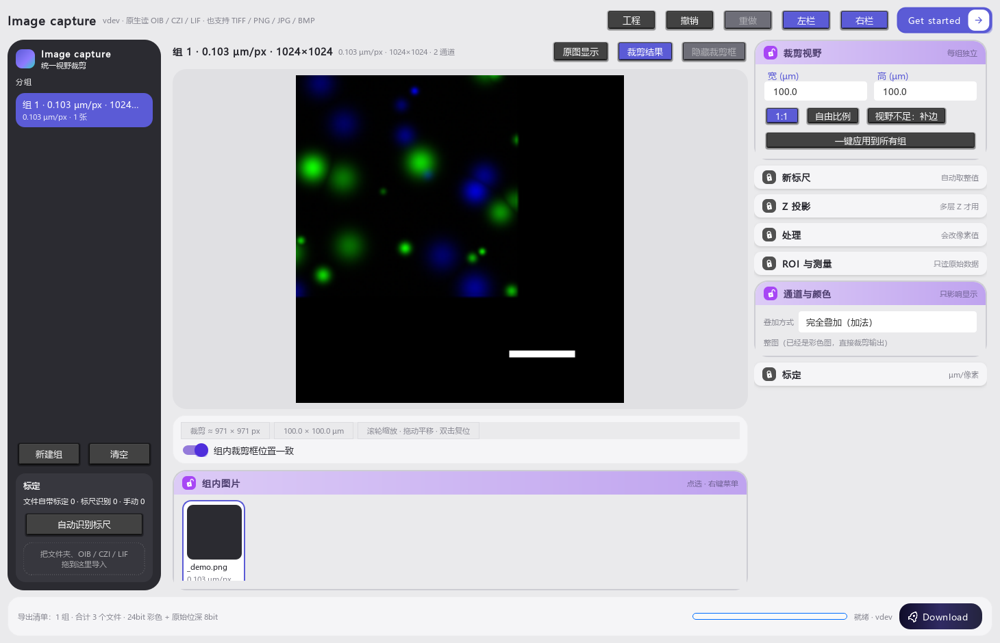
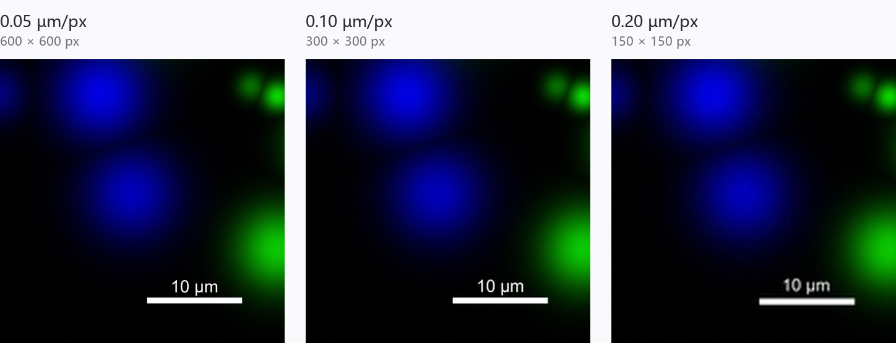

# Image capture

显微图像**统一视野裁剪** + 高清标尺 + 定量分析。把 OIB / CZI / LIF / TIFF / PNG / JPG / BMP
读进来，按同一个物理视野裁成小图，统一加标尺、调通道配色，导出彩图 + 原始位深数据 + 可选统计。
**全部本地离线运行，Windows 单机，中文界面。**

> Uniform-field-of-view cropper for microscopy images: crops to a physical field,
> burns a high-quality scale bar, maps channels, and exports 24-bit composites plus
> untouched raw-bit-depth TIFF. Offline, Windows, Chinese UI.



## 特点：同一物理视野，跨不同像素尺寸

同一块样品、同一块 **30 × 30 µm** 区域，在三种不同采集分辨率下裁出来——视野完全一致，
只是像素数不同。这就是「统一视野」的意义：**比较的是同一块物理区域，不是同一块像素区域**。



| 采集分辨率 | 30 µm 裁出来 | 10 µm 标尺 |
|---|---|---|
| 0.05 µm/px | 600 × 600 px | 200 px |
| 0.10 µm/px | 300 × 300 px | 100 px |
| 0.20 µm/px | 150 × 150 px | 50 px |

标尺按**物理长度**绘制，在任何分辨率下都指向同一个 µm 数；导出时按放大倍数同步写入
分辨率元数据，放进 Fiji / ImageJ 里量出来仍是同一个物理尺寸。

## 下载

- **便携版（推荐，Windows x64）**：
  [下载 v1.2（170 MB）](https://github.com/wzf771/image-capture/releases/download/v1.2/ImageCapture-1.2-portable-win64.zip)
  · [所有版本](../../releases)
  
  解压到任意目录，双击 `Image capture.exe` 即可（无需安装 Python）。
- **源码运行**：见下方「安装 / 运行」。

## 功能

| 模块 | 说明 |
|---|---|
| 读写 | OIB / OIF / CZI / LIF / LOF / XLIF / TIFF / OME-TIFF / PNG / JPG / BMP |
| 统一视野裁剪 | 按 µm 裁剪（默认 30 µm，支持 1:1 或自由比例），视野不足可补边 / 跳过 / 缩小 |
| 标尺 | 高清标尺，支持**标尺 OCR 自动定标**、竖/横标尺、候选选择、位置拖拽 |
| 通道 | 配色、叠加方式（加法 / 最大强度）、逐帧显示区间、黑白点 |
| 原始位深导出 | 16bit OME-TIFF，不拉伸、不烘焙显示区间；处理链可内嵌并可精确还原 |
| 定量 | ROI（矩形/椭圆/直线/点）测量、线剖面、共定位、粒子计数，导出 CSV |
| 处理 | Z 投影、正交视图（XZ/YZ）、通道配准、百分位扣背景、漂移校正 |
| 拼图 | 多 tile 文件阵列自动识别与拼接 |
| 工程 | `.icproj` 工程文件、自动保存、崩溃恢复、撤销/重做 |

## 系统要求

- Windows 10 / 11（64 位）
- Python 3.12
- 显卡无特殊要求（Qt Widgets，纯 CPU 渲染）

## 安装

```bat
python -m venv .venv
.venv\Scripts\activate
pip install -r requirements.txt
```

依赖里 `PySide6` 是 **LGPL-3.0**，其余为 BSD / MIT / Apache-2.0。

## 运行

```bat
python app\main.py
```

程序会在自身目录下建 `config/`（设置与工程）、`cache/`（缩略图）、`output/`（导出）、`logs/`（日志）。

## 安装包（可选）

本仓库不含 Python 运行时。作者内部用的是"便携 Python + 双击启动"的分发包；
如需打包，可把 `app/`、`assets/` 和依赖一起复制，用 `pythonw.exe app\main.py` 启动。

## 目录结构

```
app/
  main.py         入口（日志 / 异常兜底 / 主窗口）
  paths.py        全部路径的唯一来源（相对程序目录）
  core/
    loader.py     格式探测与解码、通道配色、逐帧区间
    render.py     合成 / 裁剪 / 屏幕锐化 / 导出内核
    bar.py        标尺绘制 + 标尺 OCR
    model.py      数据模型（通道 / 图片 / 组 / 设置）
    project.py    .icproj 工程文件与撤销栈
    raw.py        原始位深 TIFF/OME 写出
    analysis.py   ROI 统计 / 线剖面 / 共定位 / 粒子
    roi.py        ROI 模型
    register.py   配准 / 扣背景 / 漂移
    zproj.py      Z 投影
    stitch.py     多 tile 拼图
  ui/             主窗口、画布、控件、卡片、对话框、主题
tests/            回归自检脚本（需要样本图，见下）
docs/             功能说明、使用说明、截图
assets/           图标
```

## 自检

`tests/` 里是 26 个回归脚本，**依赖一组样本显微图**，公开仓库不含样本。
把样本根目录告诉它们即可（默认根目录 `E:\XY`，可用环境变量覆盖）：

```bat
set IMAGECAPTURE_SAMPLES=D:\samples
set IMAGECAPTURE_SAMPLES_CZI_DIR=D:\samples\czi
python tests\smoke.py
python tests\sharpness_baseline.py check
```

缺样本的脚本会自行跳过。界面类脚本使用 `QT_QPA_PLATFORM=offscreen` 离屏运行。

## 数据安全

- **输入文件只读**：程序不会改写原始 OIB / CZI / LIF / TIFF。
- **统计只读原始位深数据**：显示区间、屏幕锐化不参与测量。
- 原始位深导出遇到处理链时，主页面是链后数据，链前数据内嵌在 TIFF 私有 tag 里，可精确还原。
- 设置与工程只写 `config/`。

## 已知限制

- 仅 Windows（依赖系统字体与路径习惯）。
- 专有格式只读：OIB / CZI / LIF 不支持写回。
- 大图整体读入内存，峰值约为文件大小的 2 倍。
- 界面文案为中文。

## 许可

[MIT](LICENSE)。第三方库遵循各自许可（PySide6 为 LGPL-3.0，动态链接使用）。

## 免责声明

- 本项目与 Olympus、Zeiss、Leica 无任何关联，未使用其专有代码；
  格式支持基于公开规范与开源库（`oiffile` / `czifile` / `liffile`）。
- 仅供科研图像整理、展示与测量。**请保留原始文件**；发表时按期刊要求
  标注伪彩、裁剪与任何处理步骤。

## English summary

Image capture is an offline Windows desktop tool (Python + PySide6) for cropping
microscopy images to a uniform physical field of view, adding publication-grade
scale bars, mapping channels, and exporting 24-bit composites together with
untouched raw-bit-depth OME-TIFF. It reads Olympus OIB, Zeiss CZI, Leica LIF and
common raster formats, and includes ROI measurement, line profiles, colocalization,
particle counting, Z-projection, registration, background subtraction and tiling.
Input files are never modified. MIT licensed; PySide6 is used under LGPL-3.0.
